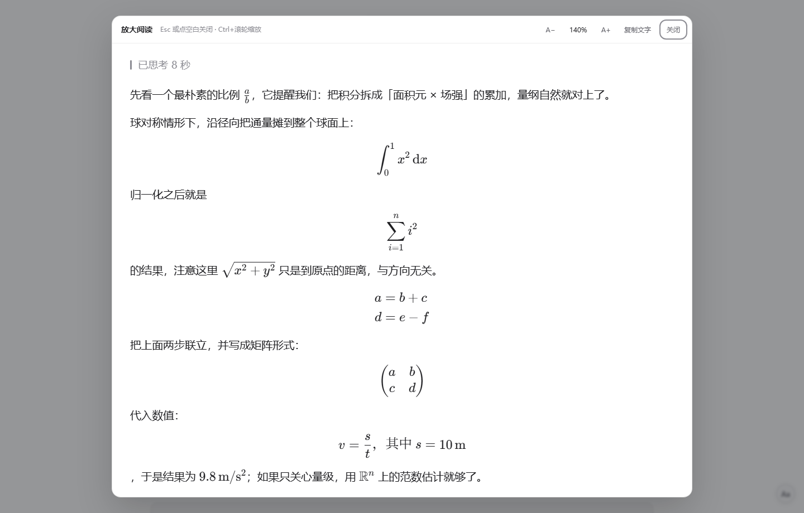

# dsh-read-zoom

给 [DeepSeek Harness](https://github.com/deepseek-ai/deepseek-harness)（DSH）的每条回答加一个**固定位置**的「放大阅读」入口：点开是一条回答的全屏大字号阅读面板，公式、表格、代码、图片都按原样保留，可以随手把字号调到舒服为止。

> 动机很朴素：会话里的正文字号偏小，长时间读长回答（尤其带推导和公式的）眼睛累。DSH 设置里能调全局字号，但要为「只想把这一条看大一点」改全局设置并不划算。

## 它做了什么

1. **回答操作行常驻按钮**：在每条回答底部的操作行里、`用量` 图标的左边插入一个「放大」按钮。位置固定，不跟随鼠标、不随滚动漂移；外观复用同排原生按钮的 class，深浅色主题自动一致。
2. **全屏阅读浮层**：面板内容是该条回答 DOM 的克隆（KaTeX 公式、表格、Mermaid、代码块、图片都在），用 CSS `zoom` 整体等比放大，默认 140%，范围 80%–300%。
3. **顶部工具栏**：`A−` / `A+` 步进 10%、百分比数字（点击回到 140%）、`复制文字`、`关闭`。
4. **其它入口**：右下角常驻 `Aa` 小按钮（放大视口里最近的一条回答）、`Alt+Z` 快捷键；浮层内 `Ctrl`/`⌘` + 滚轮缩放、`Esc` 或点空白处关闭。
5. 缩放比例记在 `localStorage`（键 `dsh-read-zoom:zoom`），下次打开沿用。

不替换 DSH 的 Markdown 渲染器、不改 `app.asar`、不新增依赖、不联网——纯粹在渲染结果上做 DOM 增强。

## 界面

操作行里的「放大」按钮（位于 `用量` 左边）：


点开后的阅读面板（140%）：



调到 200% 时的效果：


> 上面三张图来自本地渲染验证环境：用的是 DSH 前端自身的样式表与 KaTeX 资源，字号、配色、公式排版与真实界面一致。

## 安装

```bash
# 从 npm（若已发布）
dsh plugin add dsh-read-zoom

# 或直接从 GitHub 源码安装
dsh plugin add github:liuyifeng-code/dsh-read-zoom
```

也可以在 DSH Web 的左侧栏「插件 → 添加插件」里粘贴仓库地址或本地目录。

装好后**让页面重新加载一次**（`Ctrl+Shift+R`；不行就彻底退出 DSH 再启动），新按钮才会出现。

## 使用

- 每条回答底部出现一排操作图标：复制 / 点赞 / 点踩 / 分支 / **放大** / 用量 / 时间——点「放大」即可。
- 面板里：`A−`、`A+`、点百分比复位、`复制文字`（复制这条回答的纯文本）、`关闭`。
- 键盘：`Alt+Z` 打开最近一条回答，`Esc` 关闭。

## 兼容性

- 在 DSH 0.2.2-rc.1（桌面版，Web 前端）上开发与验证。
- 插件纯前端（client 半边），Host 半边是空实现：不注册服务、不改路由、不加依赖，所以版本升级后失效的最大代价是「按钮不出现」，不会影响会话本身。
- 按钮定位依赖 DSH 前端的两处稳定标记：消息操作行根节点的 `data-turn-tail`，以及操作行内的 `_endInfo` 容器；两者缺失时会退化成「插在操作行末尾」或跳过，不影响其它功能。

## 卸载

在「插件」页移除，或：

```bash
dsh plugin remove dsh-read-zoom
```

## 调试

浏览器控制台：

```js
window.__DSH_READ_ZOOM__          // { version, openLast(), close(), messages(), peek() }
window.__DSH_READ_ZOOM__.peek()   // { version, overlayOpen, tailButtons, fab }
window.__DSHZR_LOG__              // 最近 200 条内部日志
```

`peek().version` 可以确认当前加载的是哪个版本；`tailButtons` 是已插入的按钮数量。

## English

**dsh-read-zoom** adds a fixed "enlarge" button to every answer's action row in DeepSeek Harness and opens that answer in a full-screen reading panel. The panel is a clone of the rendered answer, so KaTeX math, tables, Mermaid diagrams, code blocks and images keep their exact rendering; text is scaled with CSS `zoom` (80%–300%, default 140%). There is also a floating `Aa` button and an `Alt+Z` shortcut. No renderer replacement, no `app.asar` patching, no dependencies, no network access.

## License

MIT © 2026 liuyifeng-code
