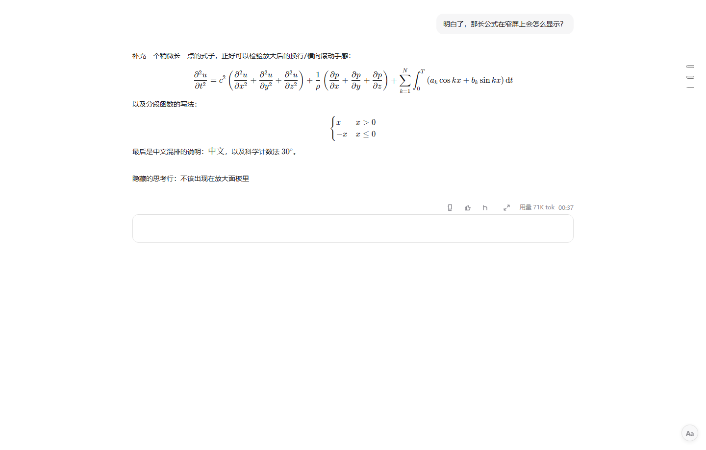
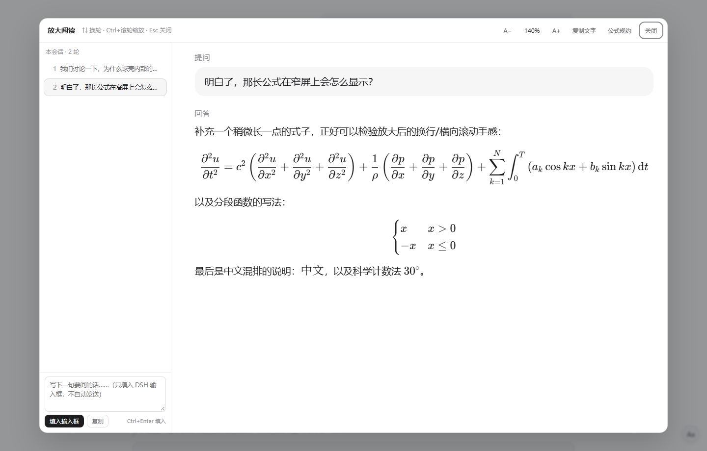
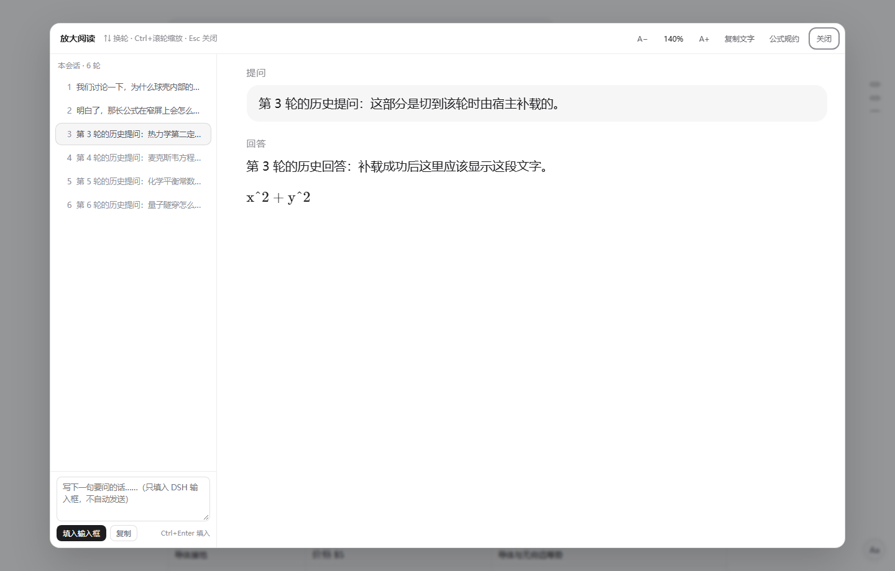
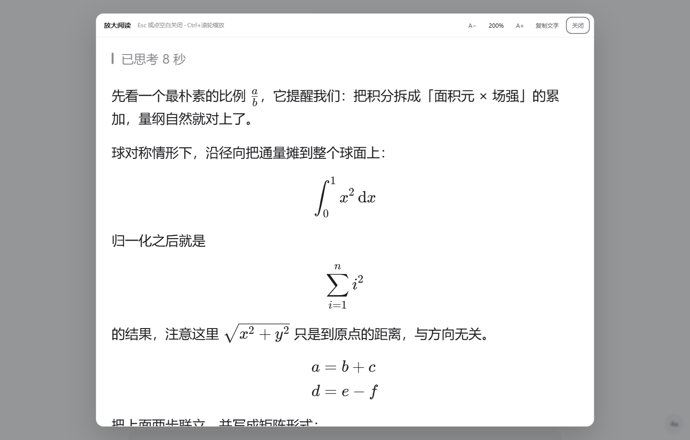
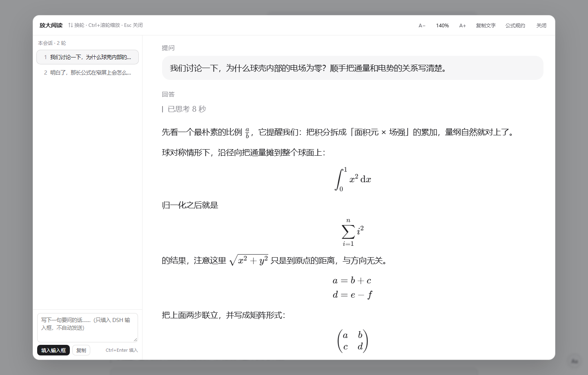

# dsh-read-zoom

给 [DeepSeek Harness](https://github.com/deepseek-ai/deepseek-harness)（DSH）的每条回答加一个**固定位置**的「放大阅读」入口：点开是一个**两栏**的全屏阅读区 —— 右边是这一轮「提问 + 回答」的大字号正文，左边是本会话的轮次列表与一个随手写字的输入框。公式、表格、代码、图片都按原样保留。

> 动机很朴素：会话里的正文字号偏小，长时间读长回答（尤其带推导、公式、化学式的）眼睛累。DSH 设置里能调全局字号，但「只想把这一条看大一点」去改全局设置并不划算。

## 它做了什么

1. **回答操作行常驻按钮**：在每条回答底部的操作行里、`用量` 图标的左边插入一个「放大」按钮。位置固定，不跟随鼠标、不随滚动漂移；外观复用同排原生按钮的 class，深浅色主题自动一致。
2. **两栏阅读浮层**（v0.3.0）：右边是整轮「提问 + 回答」的 DOM 克隆（KaTeX 公式、表格、代码块、图片都在），用 CSS `zoom` 整体等比放大，默认 140%，范围 80%–300%。
3. **左栏轮次列表**（v0.3.0，v0.3.1 改为全量）：列出本会话**所有**轮次（带提问摘要），点任意一行或按 `↑` / `↓` 切换到那一轮的提问 + 回答，当前轮高亮。列表取自 DSH 原生轮次导航，所以还没加载进 DOM 的历史轮次也在；点这样的轮次会先让 DSH 补载历史（带「正在载入」提示，最多等 6 秒，失败可重试）。
4. **左栏输入框**（v0.3.0）：写完点「填入输入框」把文字写进 DSH 的真实输入框，**只填入、不自动发送**，你确认后再按回车；`Ctrl`/`⌘ + Enter` 同效。这样看完一大段推导可以接着问，不用先退出浮层。
5. **公式友好**（v0.3.0）：渲染失败的公式（DSH 会显示成红字 `.katex-error`）在浮层里降级为灰底等宽原文，不再刺眼；超宽的独立公式按可用宽度等比缩小，不再只能横向滚动；顶栏 `公式规约` 一键复制数学 / 化学的输出规约（9 条）。
6. **不打扰主线程**（v0.3.2）：浮层打开期间不扫描时间线，滚动与输入不比原界面更重；打开/滚动/打字都不再因为整屏模糊或批量重排而卡顿。
6. **顶部工具栏**：`A−` / `A+` 步进 10%、百分比数字（点击回到 140%）、`复制文字`、`公式规约`、`关闭`。
7. **其它入口**：右下角常驻 `Aa` 小按钮、`Alt+Z` 快捷键；浮层内 `Ctrl`/`⌘` + 滚轮缩放、`Esc` 或点空白处关闭。
8. 缩放比例记在 `localStorage`（键 `dsh-read-zoom:zoom`），下次打开沿用。

不替换 DSH 的 Markdown 渲染器、不改 `app.asar`、不新增依赖、不联网——纯粹在渲染结果上做 DOM 增强。

## 界面

操作行里的「放大」按钮（位于 `用量` 左边）：



两栏阅读区：左栏轮次列表 + 输入框，右边是这一轮的提问与回答（140%）：



历史轮次还没加载进 DOM 时，点一下会先让 DSH 补载（v0.3.1）：



放大到 200%：



在浮层里接着写下一句（只填入 DSH 输入框，不自动发送）：



> 截图来自本地渲染验证环境：用的是 DSH 前端自身的样式表与真实的 KaTeX 资源，字号、配色、公式排版与真实界面一致。

## 数学 / 物理 / 化学

插件不打包 KaTeX（DSH 自带 0.18.7），也不改它的渲染管线；它把「公式为什么红」的解法做成了可分发的东西：

| 问题 | 处理 |
| --- | --- |
| 模型写了 KaTeX 不支持的宏（`\label`、`\ref`、行内 `\tag`、`\SI`、`\qty`、`\unit`、`\ce`、`\pu`） | DSH 会渲染成 `.katex-error` 红字；浮层里改成灰底等宽原文，可复制后改写 |
| 行间公式太宽，DSH 原生只能横向滚动 | 浮层里按可用宽度等比缩小（下限 0.45em），整条公式看得全 |
| 不知道怎么写才不红 | 顶栏「公式规约」一键复制 9 条规约（数学 8 条 + 化学 1 条），可粘进 `AGENTS.md` 或直接发给模型 |

规约是从 DSH 0.2.2 的真实 KaTeX 版本（0.18.7）逐条测出来的：52 个典型公式里 41 个直接通过，补 mhchem 后 44 个；剩下 8 个是 KaTeX 本身不支持，只能用替代写法。化学式建议用 `\mathrm{}` + `\rightarrow` / `\rightleftharpoons` / `\xrightarrow{\text{…}}` / `\downarrow`，不要用 `\ce{}` / `\pu{}` / `\SI{}` / `\qty{}` / `\unit{}`。

## 安装

```bash
# 从 npm（若已发布）
dsh plugin add dsh-read-zoom

# 或直接从 GitHub 源码安装
dsh plugin add github:liuyifeng-code/dsh-read-zoom
```

也可以在 DSH Web 的左侧栏「插件 → 添加插件」里粘贴仓库地址或本地目录。

装好后**让页面重新加载一次**（`Ctrl+Shift+R`；不行就彻底退出 DSH 再启动），新按钮才会出现。

## 使用

- 每条回答底部出现一排操作图标：复制 / 点赞 / 点踩 / 分支 / **放大** / 用量 / 时间——点「放大」即可。
- 浮层里：左栏点选轮次或 `↑` / `↓` 换轮；底部写下一句后「填入输入框」；右上角 `A−` / `A+` / 百分比复位 / `复制文字` / `公式规约` / `关闭`。
- 键盘：`Alt+Z` 打开最近一条回答，`Esc` 关闭，`Ctrl`/`⌘ + 滚轮` 缩放。

## 兼容性

- 在 DSH 0.2.2-rc.1（桌面版，Web 前端）上开发与验证。
- 插件纯前端（client 半边），Host 半边是空实现：不注册服务、不改路由、不加依赖，所以版本升级后失效的最大代价是「按钮不出现」，不会影响会话本身。
- 定位依赖 DSH 前端的几处稳定标记：操作行根节点 `data-turn-tail`、操作行内的 `_endInfo` 容器、时间线的 `[data-chat-turn]` / `[data-conversation-session]`、轮次导航 `nav[aria-label="轮次导航"]` 里的 `button[class*="mark"]`；缺失时会逐级退化成「插在操作行末尾」「只列出已加载的轮次」「只显示单条回答」，不影响其它功能。

## 卸载

在「插件」页移除，或：

```bash
dsh plugin remove dsh-read-zoom
```

## 调试

浏览器控制台：

```js
window.__DSH_READ_ZOOM__          // { version, openLast(), close(), messages(), peek() }
window.__DSH_READ_ZOOM__.peek()   // { version, overlayOpen, tailButtons, fab, panelTurns, activeTurn, compose }
window.__DSHZR_LOG__              // 最近 200 条内部日志
```

`peek().version` 可以确认当前加载的是哪个版本；`tailButtons` 是已插入的按钮数量；`panelTurns` 是左栏列出的轮数；`railMarks` 是原生轮次导航里找到的刻度数量（0 表示没找到，此时列表退化为「只列已加载轮次」）。

## 更新记录

- **0.3.2**：性能 — 去掉遮罩层的整屏 `backdrop-filter: blur()`（滚动/输入时每次重绘都要重新模糊背后整页聊天 DOM，是「一卡一卡」的主因）；浮层里删掉每个公式的 MathML 副本；超宽公式改「一次量完再一次写样式」；操作行按钮的 `MutationObserver` 改为空闲时扫描、浮层打开期间不扫；左栏提问摘要只补可见行，滚动时再补。面板加 `contain: layout paint`。
- **0.3.1**：修两个实测问题 —— ① 轮次列表只显示已加载的少数几轮（DSH 时间线虚拟滚动，历史轮次不在 DOM 里），现在改读 DSH 原生轮次导航列出全部轮次，点未加载轮次会等 DSH 补载历史（带提示与重试）；② 右栏出现多个空「回答」（把折叠思考、隐藏占位、`turn-tail` 行也克隆了），现在按行类型过滤、每轮合并成「提问」「回答」两段。关闭浮层时还原主聊天区滚动位置。
- **0.3.0**：两栏阅读区 —— 左栏轮次列表（点击 / `↑↓` 切换提问+回答）+ 底部输入框（只填入、不发送）；公式相关增强（失败公式降级、超宽公式缩放、`公式规约` 一键复制）。
- **0.2.2**：修「切换会话后点放大，面板里是上一个会话的回答」—— 先按会话容器 `data-conversation-session`、再按轮次 `data-chat-turn` 定位。
- **0.2.1**：移除悬停药丸（会跟消息/滚动漂移），入口改为操作行常驻按钮。
- **0.2.0**：放大按钮常驻到每条回答操作行的「用量」左边。
- **0.1.0**：首个版本，悬停药丸 + 右下角 `Aa` + `Alt+Z`。

## English

**dsh-read-zoom** adds a fixed "enlarge" button to every answer's action row in DeepSeek Harness and opens a two-pane full-screen reading view. The right pane is a clone of that turn's prompt and answer, so KaTeX math, tables, code blocks, Mermaid diagrams and images keep their exact rendering, scaled with CSS `zoom` (80%–300%, default 140%). The left pane lists **every** turn in the current session (read from DSH's native turn navigator, including turns that are not loaded into the DOM yet — clicking one asks DSH to backfill its history) with prompt summaries, and lets you compose the next message — it is **written into DSH's real composer but never auto-sent**. Formula helpers: failed KaTeX renders fall back to grey monospace source instead of red text, overly wide display math is scaled down to fit, and a `公式规约` button copies a tested set of math/chemistry output rules. No renderer replacement, no `app.asar` patching, no dependencies, no network access.

## License

MIT © 2026 liuyifeng-code
